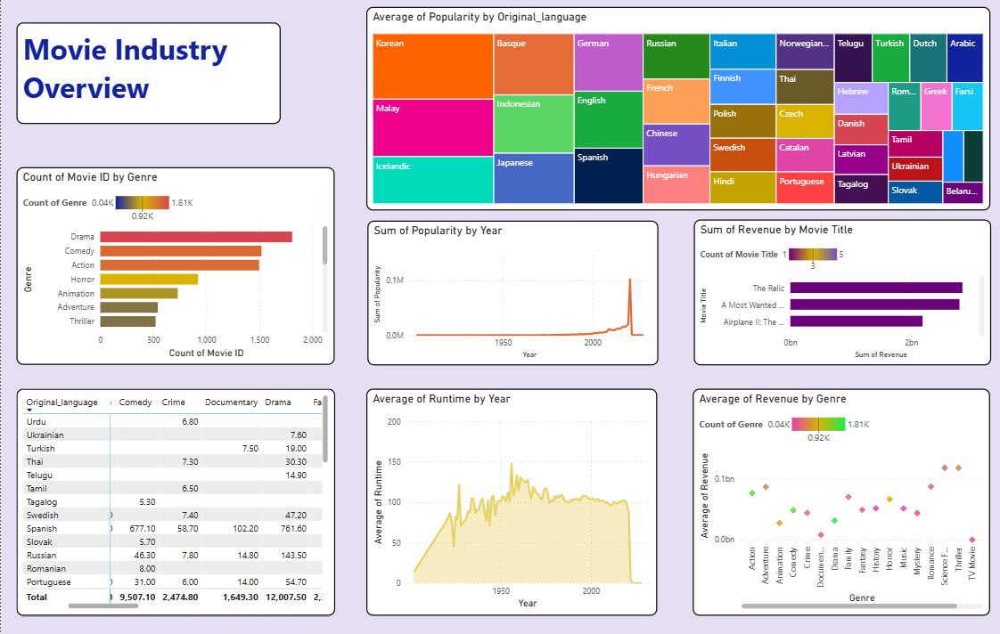

# 🎬 Movie Industry Overview – Power BI Dashboard

## 📌 Project Overview
The **Movie Industry Overview** is an interactive Power BI dashboard designed to analyze movie industry data and identify trends in movie genres, popularity, revenue, runtime, and original languages.

This project provides insights into movie performance across different years and genres, helping users understand industry trends and audience preferences through data visualization.

## 🎯 Project Objectives
- Analyze the distribution of movies across different genres.
- Understand movie popularity by original language.
- Track popularity trends over the years.
- Identify movies generating the highest revenue.
- Analyze average movie runtime by year.
- Compare revenue performance across different genres.

## 📊 Dashboard Features

### 1. Movie Count by Genre
- Analyzes the number of movies across different genres.
- Identifies the most common movie genres.

### 2. Popularity by Original Language
- Visualizes movie popularity across different languages.
- Compares the popularity of movies from different language industries.

### 3. Popularity Trends by Year
- Tracks changes in movie popularity over time.
- Highlights significant popularity trends.

### 4. Revenue by Movie Title
- Identifies movies with the highest revenue.
- Compares revenue performance across movie titles.

### 5. Average Runtime by Year
- Analyzes changes in average movie runtime over time.
- Identifies runtime trends in the movie industry.

### 6. Average Revenue by Genre
- Compares revenue performance across different genres.
- Helps identify genres with stronger revenue performance.

### 7. Genre and Language Analysis
- Provides a detailed comparison of movie genres and original languages.

## 🛠️ Tools & Technologies Used
- Microsoft Power BI
- Power Query
- DAX (Data Analysis Expressions)
- Data Visualization
- Data Analysis

## 📈 Key Skills Demonstrated
- Data Cleaning and Transformation
- Data Modeling
- DAX Calculations
- Interactive Dashboard Development
- KPI Analysis
- Trend Analysis
- Business Intelligence Reporting

## 📁 Project Files
- `Movie_Industry_Overview.pbix` – Power BI dashboard file.
- `Movie_Industry_Overview.png` – Dashboard preview.

## 🖥️ Dashboard Preview

## 💡 Project Outcome
This project demonstrates how Power BI can be used to transform movie industry data into meaningful visual insights. It helps understand genre distribution, language popularity, revenue performance, and historical movie trends through an interactive dashboard.

---

**Developed by: Mohan Samoji**

Aspiring Data Analyst  
Tools: Power BI | Power Query | DAX
